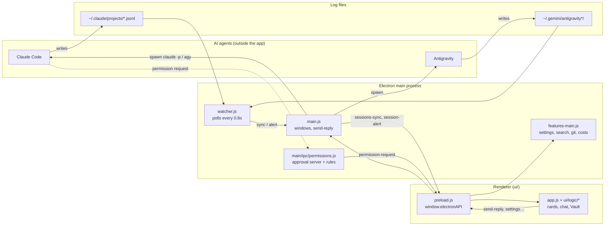
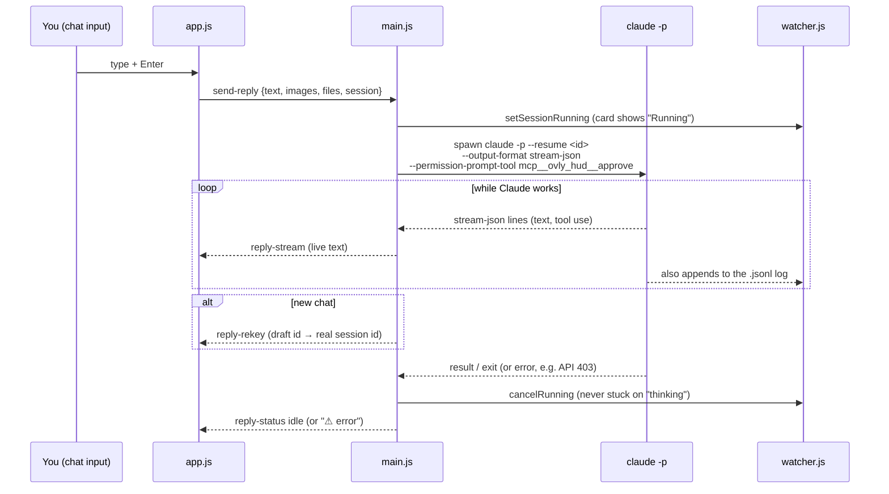
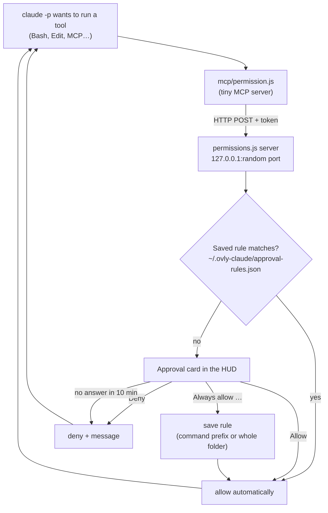
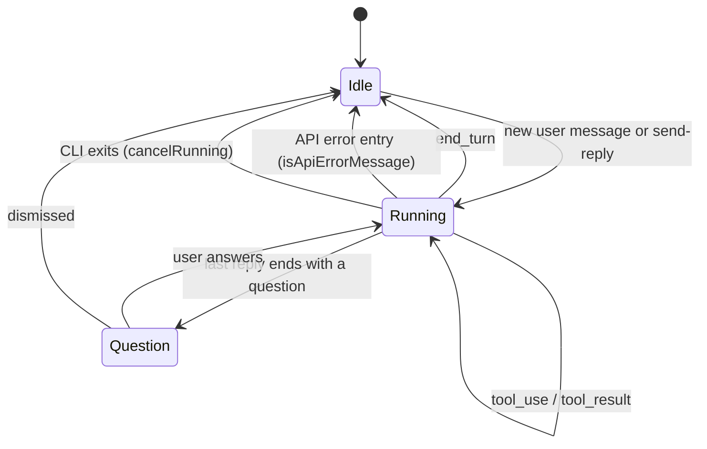

# How ovly-claude works

Four diagrams, from the big picture down. They render in VS Code's Markdown preview and on GitHub.

## 1. Big picture

The app never talks to an AI service directly. It **reads the agents' log files** to show status, and **starts the agents' CLIs** to send messages.

## 2. Sending a message

Antigravity takes the same path using `agy` instead of `claude -p`. If `agy` is not installed, the app pastes the message into the Antigravity window as a fallback.

## 3. Tool approvals

Saved rules can be reviewed and deleted in **Settings → Approval rules** (`ui/logic/system/rules.js`).

## 4. Session status

`watcher.js` works this out from the log on every poll. A **Question** raises a `session-alert`: the HUD expands and plays a chime.

## Where to look

| Area | File |
|---|---|
| Reading logs, session state | `watcher.js` |
| Windows, sending messages, MCP list | `main.js` |
| Approvals and rules | `main/ipc/permissions.js`, `mcp/permission.js`, `approval-shell.js` |
| Settings, search, git, costs | `features-main.js` |
| Bridge between main and UI | `preload.js` |
| Main UI | `ui/app.js` |
| Chat extras, nav, Vault, themes | `ui/logic/*`, `ui/styles/*` |
